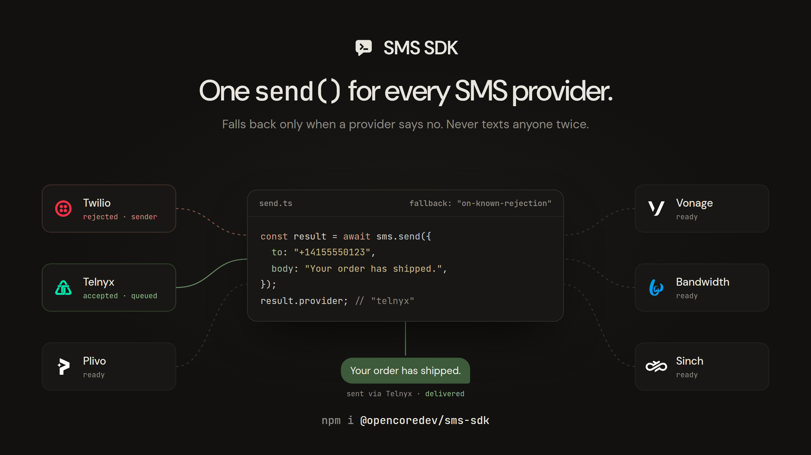

<p align="center">
  <a href="https://sms-sdk.vercel.app"></a>
</p>

<p align="center">
  <a href="https://www.npmjs.com/package/@opencoredev/sms-sdk"></a>
  <a href="https://github.com/opencoredev/sms-sdk/stargazers"></a>
  <a href="https://x.com/leodev"></a>
</p>

SMS SDK is an open-source TypeScript library for sending and receiving transactional SMS through Twilio, Telnyx, Plivo, Vonage, Bandwidth, or Sinch with one typed API. Switch providers by changing one import, add a second provider as a fallback, and verify every provider's webhooks the same way.

It never texts anyone twice: it falls back only when a provider proves it refused the message, and stops when the outcome is unknown.

[Start with the quick start](https://sms-sdk.vercel.app/getting-started/quick-start) · [Read the docs](https://sms-sdk.vercel.app) · [Install from npm](https://www.npmjs.com/package/@opencoredev/sms-sdk)

- Adapters for Twilio, Telnyx, Plivo, Vonage, Bandwidth, and Sinch, each behind its own subpath import
- Opt-in fallback to the next provider after a known rejection, with rate-limit retries that honor `Retry-After`
- Typed errors that say whether sending again is safe, and idempotency keys that stop duplicate sends
- Verified, normalized webhooks for delivery status, replies, and STOP/HELP opt-outs
- A `memory()` adapter and signed webhook builders for tests that never touch the network
- Zero runtime dependencies, ESM, Node.js 20+ and Bun

## Install

SMS SDK runs in server-side code. Keep provider credentials and webhook secrets out of browser bundles.

```bash
npm install @opencoredev/sms-sdk
# or
bun add @opencoredev/sms-sdk
```

## Usage

Create a client with one or more adapters and call `send()`:

```ts
import { createSmsClient } from "@opencoredev/sms-sdk";
import { twilio } from "@opencoredev/sms-sdk/twilio";
import { telnyx } from "@opencoredev/sms-sdk/telnyx";

const sms = createSmsClient({
  adapters: [
    twilio({ accountSid: process.env.TWILIO_ACCOUNT_SID!, authToken: process.env.TWILIO_AUTH_TOKEN!, from: "+15550100001" }),
    telnyx({ apiKey: process.env.TELNYX_API_KEY!, from: "+15550100002" }),
  ],
  fallback: "on-known-rejection",
});

const result = await sms.send({ to: "+14155550123", body: "Your order has shipped." });

console.log(result.provider);
// "telnyx" when Twilio refused the sender
```

`send()` resolves only when a provider accepted the message. A refusal throws `ProviderRejectedError` with `retrySafe: true`. A timeout or unreadable response throws `HandoffUnknownError` with `retrySafe: false`, and the SDK neither retries nor falls back, because the text may already be on its way. [How sending works](https://sms-sdk.vercel.app/getting-started/how-sending-works) covers every outcome and default.

No provider account yet? Swap in `memory()` from `@opencoredev/sms-sdk/testing`. It records every send and calls nothing.

## Providers

| Provider | Status | MMS | Scheduling | Webhook verification |
| --- | --- | --- | --- | --- |
| [Twilio](https://sms-sdk.vercel.app/providers/twilio) | supported | yes | yes (Messaging Service) | HMAC-SHA1 |
| [Telnyx](https://sms-sdk.vercel.app/providers/telnyx) | supported | yes | yes | Ed25519 |
| [Plivo](https://sms-sdk.vercel.app/providers/plivo) | partial | yes | no | HMAC-SHA256 V2 |
| [Vonage](https://sms-sdk.vercel.app/providers/vonage) | partial | no | no | HS256 JWT |
| [Bandwidth](https://sms-sdk.vercel.app/providers/bandwidth) | partial | no | no | Basic credentials |
| [Sinch](https://sms-sdk.vercel.app/providers/sinch) | partial | no | yes | Basic or HMAC |

Partial means part of the provider's behavior is undocumented, so fewer rejections can be recognized for fallback. [`PROVIDERS.md`](packages/sms-sdk/PROVIDERS.md) lists every provider fact the SDK relies on, its source, and what could not be confirmed. [Choose a provider](https://sms-sdk.vercel.app/providers/overview) has the full capability matrix.

## Webhooks

One parser verifies the request before reading it and returns the same event shape for every provider:

```ts
import { parseSmsWebhook } from "@opencoredev/sms-sdk/webhooks";

const event = await parseSmsWebhook({
  provider: "telnyx",
  request,
  credentials: { publicKey: process.env.TELNYX_PUBLIC_KEY! },
});
// event.type: "message.delivered", "message.received", "recipient.opted_out", ...
```

See [Receive webhooks](https://sms-sdk.vercel.app/receiving/webhooks) for Next.js, Hono, and Bun handlers.

## Documentation

Full documentation lives at **[sms-sdk.vercel.app](https://sms-sdk.vercel.app)**. Coding agents can read it as Markdown, through [`llms.txt`](https://sms-sdk.vercel.app/llms.txt), or with the MCP server:

```bash
claude mcp add --transport http sms-sdk https://sms-sdk.vercel.app/mcp
```

Good places to start:

- [Quick start](https://sms-sdk.vercel.app/getting-started/quick-start)
- [Fallback and retries](https://sms-sdk.vercel.app/sending/fallback-and-retries)
- [Prevent duplicate sends](https://sms-sdk.vercel.app/sending/idempotency)
- [Test without a provider](https://sms-sdk.vercel.app/testing/local-testing)
- [Switch providers](https://sms-sdk.vercel.app/migration/switch-providers)

## Contributing

```bash
bun install
bun run test        # SDK tests
bun run typecheck   # SDK types
bun run dev         # docs site
```

Every change to the package ships with a changeset (`bun run changeset`). See [Contributing and support](https://sms-sdk.vercel.app/advanced/contributing) for the release flow, adding a provider, and reporting security issues.

## Sponsors

Want your logo here? **[Become a sponsor →](https://github.com/sponsors/opencoredev)**

<p align="center">
  <a href="https://github.com/sponsors/opencoredev">
    <picture>
      <source media="(prefers-color-scheme: dark)" srcset="https://shieldcn.dev/sponsors/opencoredev.svg?title=false&mode=dark&preset=surface" />
      <source media="(prefers-color-scheme: light)" srcset="https://shieldcn.dev/sponsors/opencoredev.svg?title=false&mode=light&preset=surface" />
      
    </picture>
  </a>
</p>

<p align="center"><sub><a href="./LICENSE">MIT License</a> · Built by <a href="https://x.com/leodev">@leodev</a></sub></p>
